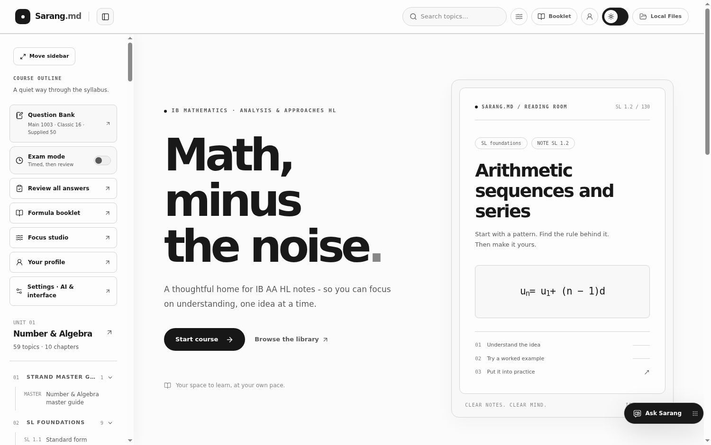
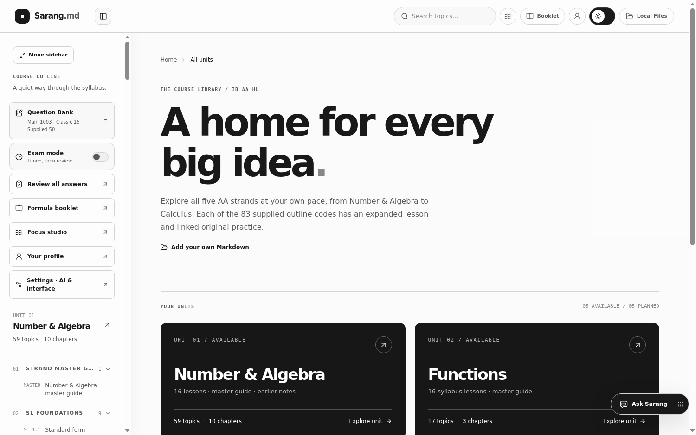
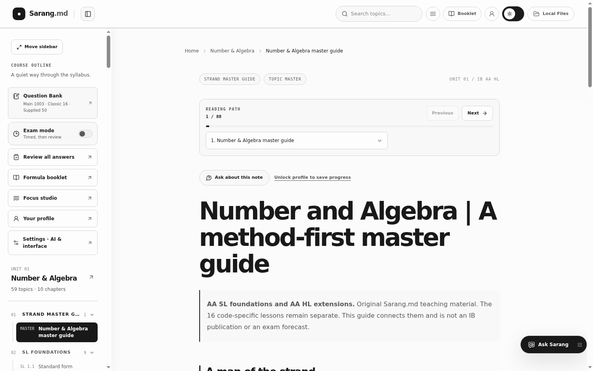
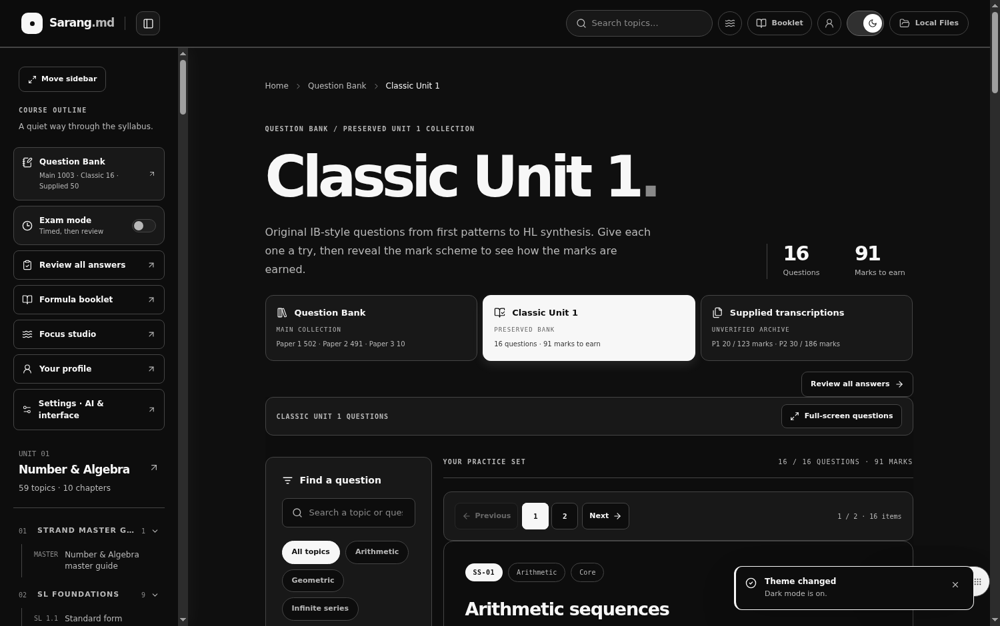
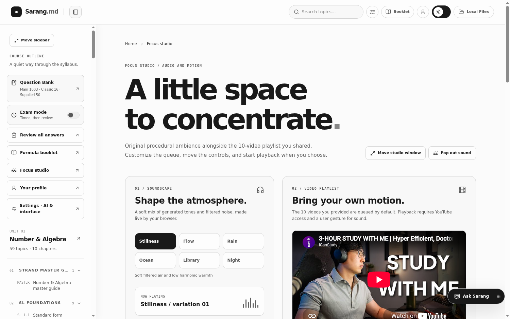
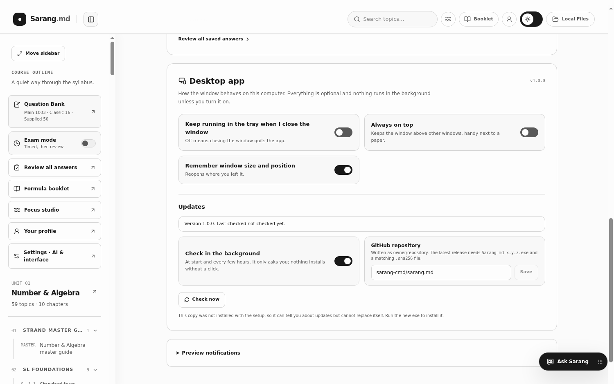

# Sarang.md

A grayscale, static-hostable Mathematics AA HL/SL study space with 83 original syllabus lessons (all 83 topics are full textbook chapters of at least 2,000 words, about 211,000 words in total), five 800+ word strand master guides, 1,069 original practice questions (90 longer curated tasks plus 913 parameterized skill variations), 20 preserved earlier notes, 22 bundled supplied notes, and a separate archive of 50 unverified transcriptions. Built with Vite, React, TypeScript, Tailwind, React Markdown/KaTeX, Fuse.js, and Zustand. Reading and practice need no account; optional Supabase Auth supports manual encrypted cloud backups.

For a current scope audit, read [Requests vs implementation](REQUESTS_VS_IMPLEMENTATION.md). For actions only the project owner can take, use the [owner setup checklist](OWNER_SETUP_CHECKLIST.md). [Remaining steps and optional ideas](NEXT_STEPS_AND_IDEAS.md) separates release blockers from future enhancements.

## Download the desktop app (Windows)

[](https://sarang-md.vercel.app/downloads/Sarang-md-Windows.exe)

One signed `.exe` with its own window: the whole course, the question bank, the formula booklet and the focus corner work offline, and your encrypted profile stays on your computer. Run it once and an animated setup offers a Start menu entry, a desktop shortcut and "Open at login" (all optional). An updater reads a feed on the website (`sarang-md.vercel.app/updates/latest.json`), verifies the SHA-256 and asks before it installs anything. Windows SmartScreen may ask you to confirm once because the certificate is self-made (More info, then Run anyway). Details, build steps and the security model are in [desktop/README.md](desktop/README.md). The website and the app are the same code and get every update together.

| | |
| --- | --- |
|  |  |
|  |  |
|  |  |

### The Sarang suite

* **Sarang.md** (this repo): IB Mathematics AA HL/SL lessons, question bank, mark schemes, formula booklet, tutor. [Website](https://sarang-md.vercel.app/)
* **[Study with Sarang](https://sarang-md.vercel.app/study-with-sarang/)**: ambient sound, goals, a floating timer and an assistant for any subject. [Downloads](https://sarang-md.vercel.app/study-with-sarang/downloads/)

Same grayscale design, same local-first privacy, same release process. Each has a website and a Windows app.

## Discord status (desktop app, off by default)

The desktop app can show what you are doing on your own Discord profile: reading the textbook, practising, a mock exam, the formula booklet or a focus block, with a live timer and the Sarang.md logo. Nothing is sent anywhere except to the Discord app on the same computer.

1. In the [Discord Developer Portal](https://discord.com/developers/applications) create an application named **Sarang.md** (that name is what Discord shows after "Playing").
2. Upload `public/app-icon-512.png` as the application icon (App Information).
3. Copy the Application ID, then in the app open Settings and paste it into the Discord card (or put it in `DEFAULT_APP_ID` in `src/lib/discord.ts` to ship it to everyone).
4. Turn on **Show my study status on Discord**. Seven switches control what is shown; the chapter name stays private unless you allow it.

A browser cannot reach Discord's local connection, so the website shows the card as a desktop-only feature with a download link. Test: `npm run test:discord` (and `node desktop/scripts/test-discord-ui.cjs` under `xvfb-run` for the real app).

## Run and build

Requires Node.js 20+.

```bash
npm ci
npm run dev
```

Open the URL printed by Vite (usually `http://localhost:5173`). For production, stop the dev server, run `npm run build`, and optionally run `npm run preview`. `dist/` contains the static build.

### Windows PowerShell: fix a stale extraction

If `npm run dev` fails with `ENOENT` for `uploads/Full_Course_Outline.md`, the project files in that folder are from an older archive. Installing packages again will not replace the old script. This archive includes the outline in `source-material/` and makes the generator read it there. Extract **Sarang-md-Math-Tutor-Booklet-Profile-2026-09-27.zip** into a new folder, not on top of the old `ver.5` folder. Keep that older folder if you have edited it or stored your own notes there.

With the downloaded ZIP in your Downloads folder, run:

```powershell
$archive = Join-Path $env:USERPROFILE 'Downloads\Sarang-md-Math-Tutor-Booklet-Profile-2026-09-27.zip'
$folder = Join-Path $env:USERPROFILE 'Downloads\Sarang-md-Math-Tutor-Booklet-Profile'
if (Test-Path -LiteralPath $folder) { throw 'Choose a new folder name so project files are not merged.' }
Expand-Archive -LiteralPath $archive -DestinationPath $folder
Set-Location $folder
Test-Path .\package.json
Test-Path .\source-material\Full_Course_Outline.md
Select-String -Path .\scripts\build-course.mjs -SimpleMatch 'source-material/Full_Course_Outline.md'
npm ci
npm run dev
```

Both `Test-Path` commands should print `True`, and `Select-String` should find the corrected source path. The URL printed by Vite opens the app. Adjust `$archive` if you saved the ZIP elsewhere or your browser renamed the download. If `npm run dev` still mentions `uploads/Full_Course_Outline.md`, check that `Get-Location` points to the **new** folder containing `package.json`. Do not create a placeholder `uploads/Full_Course_Outline.md` file. Once the new app runs, transfer any personal edits from the older folder deliberately rather than merging the folders.

## Your own Markdown: two ways

**1. Choose a folder in the app (private, works on any static host).** Click **Local Files** in the desktop header, or open the course outline and choose **Local Files** on a narrow screen. Choose the actual `Unit 1 Number and Algebra` folder on your computer, or select individual `.md` files. The app reads them **in the browser** and saves their text in that browser's IndexedDB; the notes reader does not upload them to an app server. If you choose to use the optional live tutor on a local note, an excerpt goes directly to your configured AI provider. Switch back to **Included library** any time. Choosing a folder replaces the browser import; **Choose .md files** adds or updates individual notes. If project-root notes also exist, they remain in the local library; a browser file with the same name takes priority. If your browser does not offer a folder picker, use the individual-file option. You can remove the stored import in the same dialog. Clearing browser/site data also clears your saved import, so keep your original files.

**2. Drop files into the project root (for local development / intentional static publishing).** These ready-made folders sit next to `package.json`:

```text
Unit 1 Number and Algebra/
Unit 2 Functions/
Unit 3 Geometry and Trigonometry/
Unit 4 Statistics and Probability/
Unit 5 Calculus/
```

Put Markdown files directly inside a folder, then run `npm run dev` or `npm run build`. The `predev`/`prebuild` hook runs `npm run sync:local`, discovers all `Unit N ...` folders, generates `public/content/local/catalog.json`, and copies their Markdown to `public/content/local/`. If the dev server is **already running**, run `npm run sync:local` and refresh your browser. Select **Local Files** in the app to read them. Empty units remain Coming soon; a unit becomes clickable when it has files.

**Privacy distinction:** Root-folder files are copied into the public static build and would be publicly accessible if you deploy that build. Root-folder `.md` files and the generated copy are gitignored by default, so they are not accidentally committed; use the browser picker for private notes on a hosted site. Only publish project-folder notes if you intentionally want to share them; remove the relevant `.gitignore` rule and commit those files first. **Repository warning:** the existing public `sarang-cmd/sarang.md` history already tracks Markdown files in its root `Unit 1 Number and Algebra/` folder. `.gitignore` does not untrack files already committed. Those existing files are preserved here; running the build copies them into public static content. Review them before deploying or sharing this project.

### Filenames and frontmatter

Files such as `02_Arithmetic_Sequences (2).md` work without renaming. A leading `00`–`19` automatically places Unit 1 notes under Foundations (00–01), Sequences & Series (02–08), Proof (09–12), Counting (13–15), Binomial Theorem (16–18), or Synthesis (19); additional unnumbered files appear under Resources. Adjacent links are generated from sorted filenames. Optional YAML frontmatter may define `title`, `category`, and `tags` (and takes precedence over filename-derived labels); it is stripped from the rendered page. The included demo library still uses `public/content/manifest.json` and the 20 bundled files in `public/content/Unit 1 Number and Algebra/`.

## Included five-strand course and original practice

The included course covers **83 distinct supplied outline codes** in Number and Algebra (16), Functions (16), Geometry and Trigonometry (18), Statistics and Probability (14), and Calculus (19). It distinguishes AA SL foundations from AA HL extensions. Each strand begins with an original 800+ word master guide. Every topic is a full original textbook chapter with learning objectives, core ideas, worked examples with marks, GDC advice, common mistakes, exam technique, connections, ten check questions with answers and a summary; their source is `source-material/textbook/` and `npm run check:data` fails any chapter under 2,000 prose words. Units 4 and 5 (Statistics and Probability, Calculus) are written to the same standard, so all 83 codes are full chapters. The [course writing guide](CONTENT_WRITING_GUIDE.md) remains in the source archive, not the learner-facing course catalog.

The learner's earlier supplied **IBO 2023 Version 1.0 AA HL formula booklet** was checked for printed section labels and page references. Lesson notes identify direct entries precisely and say when that edition has no dedicated row. See the source-only [formula booklet cross-check](FORMULA_BOOKLET_AUDIT.md), including corrections about permutations and distance versus displacement. The copyright PDF itself is not republished in this static archive. The new **Formula booklet** button opens an owner-provided Google Drive preview on request or a private PDF selected in your own browser; it does not put the PDF on our server. Google controls inside its own viewer cannot be removed by this app. The outline's 3,981 question figures are **quoted external counts**, not questions in this project or copied prompts.

Run `npm run sync:course` to regenerate `public/content/course-catalog.json` and its Markdown pages from versioned `source-material/Full_Course_Outline.md`, `source-material/supplied-unit1/`, `source-material/lessons/`, `source-material/depth/`, `source-material/master-guides/`, and `source-material/formula-booklet-reference.mjs`. The ignored `uploads/` directory is not needed for a clean checkout or source ZIP. `npm run check:data` checks coverage, word-count bounds, preserved notes, booklet references, math syntax and question structure, plus an independent numerical spot check of 106 new practice variants across 34 skill families. The same command checks the classic/supplied selector totals and SQL JSONB operator precedence. Structural and sampled checks are **not an independent proof of every worked answer**.

**Original practice** at `/#/practice` contains **1,069 actual questions**: the preserved 90 longer authored tasks (42 P1, 38 P2, 10 multi-part P3 investigations), **66 long-form questions for the Unit 4 and 5 codes** (two per code, 482 marks, mark schemes with M, A, R and AG marks, source in `source-material/practice/long/`, every stated number recomputed by `npm run build:long`) plus **913 original parameterized practice variations**, drawn from **262 code-specific skill families**. Exactly 11 new practice variants link to each of the 83 supplied outline codes. The overall distribution is 531 P1, 528 P2 and 10 P3. A variation changes numbers in an original authored method family; 1,069 does **not** mean 1,069 unrelated hand-written templates or an official exam bank. Solutions are independent step guides with marks, not official IB mark schemes. The supplied 50 unverified transcriptions remain separate, and the original 16-question bank is preserved.

Filter by paper, unit, subtopic, keyword, status or mark allocation in the New UI; ten results load at a time. The Old UI retains its original 80-at-a-time question list and classic filters. Save self-marked scores and stars in an unlocked encrypted profile. Seeded short mixed mocks still draw on the **90 longer tasks** and select 15:15:10 available marks from Papers 1, 2 and 3. This reflects the 30%/30%/20% external-paper weights in the IB AA HL subject brief; the exploration carries the remaining 20%. A mock is not a full exam or a forecast. Share stable question links, or use **Print / save PDF**. `npm run sync:practice` regenerates the tracked `src/data/questions/expanded.json` from versioned `source-material/practice/` without downloading or reproducing the external question counts.

The original **16-question, 91-mark sequences and series bank** at `/#/question-bank` is preserved in `public/content/question-bank/sequences-and-series.json`. It retains its original prompts and mark allocations, searches, difficulty filters and deliberate guide reveals. It is not replaced by the new paper practice. All newly authored content is original IB-style practice, not official examination material.

### One Question Bank, timed attempts and offline review

The sidebar has one **Question Bank** entry. Switch among its three collections using the cards at the top: the main **1,069** items (Paper 1 **531**, Paper 2 **528**, Paper 3 **10**), Classic Unit 1 (**16 questions, 91 marks**), and supplied transcriptions (**50 questions, 309 marks**: P1 **20/123**, P2 **30/186**). The supplied archive has uncertain source metadata and is not an official paper bank. Each collection has a full-screen question workspace. When browser fullscreen is blocked, a full-window fallback is used instead. Printing main practice uses a prompt-only, print-ready layout without answer guides.

Use the sidebar **Exam mode** switch to start a timed practice attempt of 5 to 300 minutes. The timer runs as you move between all three collections. Older answers never prefill a fresh exam. Guides, numeric checks, self-marking, tutor and optional AI actions are hidden until submission or timeout. Choose **Finish exam** or **Submit and review** to unlock `/#/review`. This is not secure proctoring: the static site's solution data remains downloadable by someone using browser tools. Timed work is not an official mark or an automatic written-proof grade.

Every question accepts a typed answer. In **Review all answers**, compare your working with independent guides, see exact-value matches on supported numeric targets, and award your own marks. Written answers and self-marks are encrypted at rest when your local profile is unlocked; without one, they stay in memory in the current tab and disappear on refresh. The saved-answer view includes previous timed answers from an unlocked profile. AI critique is only an optional, explicitly confirmed request when AI is enabled and your own provider key is configured; it never supplies an official grade. Switch **AI features** off under `/#/settings` to remove the tutor and block AI calls. In those Settings, **Original / Old** or **Organized / New** switches the *whole app*; you can override questions, reading, profile or tools individually and adjust spacing or theme. Interface preferences are device-local and do not contain written answers.

## Deploy (Vercel, or any static host)

Deploy the **contents of `dist/`**. The app uses hash URLs (`/#/units/...` and `/#/question-bank`) and a relative Vite base, so it works under `/` or `/your-repo/` without SPA rewrites. The live site is the Vercel project `sarang.md` at `https://sarang-md.vercel.app/`, together with the downloads page (`/downloads/`), the update feed (`/updates/latest.json`) and the Study with Sarang path (`/study-with-sarang/`). The sites are generated and deployed with `site/build.mjs` in the Study with Sarang repository; its `docs/DEPLOYMENT_GUIDE.md` has the steps. The old GitHub Pages workflow is archived in `docs/archive/`. Browser-picked files are not bundled or deployed; each reader can choose their own folder in their browser.

## Navigation, notifications and component paths

The main original bank, Classic Unit 1 and supplied paper bank have numbered pages, previous/next controls and a jump-to-page field. Page numbers use one-based `?page=` values in the HashRouter URL. A direct question link takes precedence over a conflicting page number; browser Back/Forward restores deliberate page, paper, mode and question choices. Main practice uses 10 questions per page in New UI and 80 in Old UI; Classic uses 8 and supplied papers use 10. The notes reader shows the current lesson's position, an ordered previous/next path and a lesson chooser. Structured syllabus lessons continue across unit boundaries; imported and older notes keep their unit-local reading order. Page transitions and controls respect reduced-motion preferences.

Important saves, copied links, submitted exams, profile operations, changed settings and errors show short grayscale confirmation toasts. Typing, filtering and ordinary page navigation do not generate toasts. Settings includes an optional notification preview. This integration uses `src/components/ui/toast.tsx`, `src/components/ui/demo.tsx`, `src/components/ui/button.tsx`, `src/lib/utils.ts`, and a single global `<Toaster />` in `src/App.tsx`. Tailwind uses the existing ink/canvas/surface variables. There are no stock toast images. `components.json` and the `@/` aliases in TypeScript and Vite map the shadcn-style component directory to **`src/components/ui`**, because this Vite project's application code lives under `src/`, not a root-level `components/` directory. The supplied components and required packages are already integrated; running the shadcn CLI is **not required** and reinitializing could overwrite the existing grayscale configuration.

[Version messages and archive history](VERSION_MESSAGES.md) lists actual prior Git subjects separately from proposed retrospective and future release subjects. No new Git commit was made for this ZIP. Keep the file updated and include it in each later source ZIP.

## New: separate Paper 1 and Paper 2 archive

Open **Question Bank**, then choose **Supplied transcriptions**. This archive is separate from the preserved 16-question Classic Unit 1 bank. The archive contains the **50 question transcriptions you supplied**, organized by each item's stated paper: 20 marked P1 and 30 marked P2. Three P1-labeled items came from the file titled Paper 2; the app puts them under P1 and explicitly flags the source-file mismatch. Other discrepancies, including conflicting part-mark totals, mislabeled topics and reused codes across sessions, are flagged on the relevant entries. Some older `MATHL` codes refer to a predecessor Mathematics HL syllabus, not Mathematics AA HL. The prompts and exam metadata are *user-supplied transcriptions, not independently authenticated official papers*. No scans or official mark schemes were provided.

Each question has an **independently written, suggested marking guide** with method, accuracy and reasoning points summing to the question's stated header total. It is not an official IB mark scheme. The checker tests selected final **numeric** values, including fractions, decimals and `sqrt(...)`; it cannot assess method, proof, interpretation or official marks. A client-only static site necessarily ships its solution data in downloadable JSON; reveal buttons are study controls, not security controls. Reveal a guide only when you choose to. Under **Original variants**, ten new parameterized question templates (five per paper) create fresh numbers and derived answers when you press **Generate a new set**. Variants are not attributed to an examination session, zone or code.

The two original supplied Markdown files are included at `source-material/`, and the authored teaching rubrics are in `scripts/ib-guides.mjs`. Run `npm run sync:ib` after editing either to rebuild `public/content/ib-bank/archive.json`, then `npm run check:data` to validate totals, math rendering and preservation counts. The build and dev hooks regenerate it automatically. To make a correction to a transcription, update the relevant source Markdown and regenerate; the existing notes and sequences bank remain untouched.

## New: Socratic tutor

Use **Ask about this note/question** or the floating tutor button. The tutor is **mathematics-only**. Its panel can be moved or docked, minimized to a side tab, made tutor-only fullscreen, or switched to a fullscreen question-left / tutor-right practice layout. On a small screen the split layout stacks the question above the tutor. Drag the panel header on desktop or move the tab by its grip; both grips also accept arrow keys. Near Send, select a hint step: Orient, Identify, Plan, Set up, or Almost there; **Ask next hint** requests that step immediately. The six-position Shadow DOM student-effort slider, from Guided to Locked in, adjusts scaffolding independently of the hint step. Its info button explains the choice. A working indicator and text reveal animate replies unless reduced motion is enabled. The default is a short anchored question, not a solved answer. **Explain the answer for me** requires explicit confirmation and switches to solution mode; returning to hints clears that conversation. No external AI model can be guaranteed to obey a prompt, so verify replies.

Without an API key, the panel provides fixed offline guiding questions, **not live AI**. For live responses, keep AI enabled under **Settings**, then open the tutor panel's provider settings and configure your own model ID, API key and provider: OpenAI, OpenRouter, Mistral, xAI, Anthropic, Gemini/Google AI Studio, Kimi/Moonshot, or another OpenAI-compatible Chat Completions endpoint. Provider presets may change; edit model IDs and endpoint URLs to match your account. No key is embedded in the source, URLs, or build. Without an unlocked profile, credentials are temporary and are forgotten on refresh. With an unlocked profile, press **Save connection to profile** to encrypt that provider's key, model, and endpoint. Unlock the profile again on each visit to load saved connections. Plaintext connection preferences are no longer written to localStorage. Custom endpoints must use HTTPS, except local HTTP while developing on localhost.

**Browser-only privacy and deployment limits:** Requests go directly from the browser to your configured provider, including the question/note excerpt, your chat, any image you deliberately attach, and, if selected, relevant extracted booklet excerpts. Image attachment is disabled for unknown or unsupported model/endpoint combinations. The custom-provider option requires you to confirm that its Chat Completions endpoint supports image input. Only one JPG, PNG or WebP image under 2 MB can be attached at a time, only with Send; image bytes are kept in this tab and are not saved in encrypted chat history or resent on follow-up messages. Reattach it for a follow-up about the picture. Your own API key is visible to the browser, your provider and anyone with access to this browser session or its developer tools. Some providers do not allow browser-origin requests (CORS), or restrict keys and models. This project has **no backend or proxy**, so an incompatible provider endpoint cannot be made to work by adding a secret to the static build. For centrally managed or concealed keys you would need a separately deployed, authenticated server that you control. Do not paste private credentials into source files or a shared computer.

The course notes reference an earlier supplied **IBO 2023 Version 1.0 AA HL formula booklet**, but the PDF is **not bundled in the public build or automatically installed into your browser's tutor**. The new `/#/formula-booklet` page embeds the owner-provided Google Drive preview only after you choose to load it; Google may show its own buttons or require access. You can also view a private PDF using a temporary browser URL without uploading it. To let the tutor examine any chosen file in a session, select it again in Tutor settings, or import its extracted text through the encrypted **Profile → Private library** and select it after unlocking. Only relevant excerpts go to your chosen AI provider when you make a model request. PDF text extraction can omit symbols, notably the absolute-value bars around $v(t)$ on printed page 10, so check equations visually. Image-only scans need OCR. The tutor must not claim it read the full PDF when only a passage was extracted.

## Focus studio, movable windows, ambient mixer and video queue

The Focus studio makes original procedural sound in the browser with Web Audio. It has six base scenes (Stillness, Flow, Rain, Ocean, Library and Night), plus **10 independently adjustable, synthesized layers**: Rainfall, Distant thunder, Shore waves, Wind, Hearth, Birdsong, Crickets, Café, Soft bells, and White noise. The sounds are synthetic approximations, not downloaded recordings or copies of [A Soft Murmur](https://asoftmurmur.com/). Use **Mix for me** to try three gentle layers or **Clear** to silence the overlays. The custom layer mix is stored in this browser's ordinary localStorage, outside the encrypted vault. Adjust master volume, regenerate a variation, and choose a 25/50-minute or unlimited sound timer. Playback requires a click. Sound can keep playing while you navigate within the app, with a mini player available off the Focus page. If your encrypted profile is unlocked, focus intervals are recorded when paused, finished or changed. No therapeutic effect, brainwave alignment or performance gain is promised. A longer in-app explanation distinguishes social study cues from measured auditory-brain phase locking and links the underlying study.

Your **10-video unlisted YouTube playlist** is the default queue in its original order. Links can be renamed, added, removed or moved, and the defaults can be restored after confirmation. Local video files remain only for the visit. The selected queue position, mute and loop settings survive a refresh; playback itself does not auto-start on a new page visit. Play/pause/mute controls command an embedded YouTube iframe without resetting its URL, and direct files use native video controls. Browser policies may block unmuted or automatically advanced playback despite a click, and creators may disable embedding. An external video needs network access, and viewing may send data to YouTube. All local video files remain on your device.

On a desktop, you can undock and drag the **whole Focus Studio panel**, **whole course sidebar**, or **whole sound-controls window** from its header. The same headers support arrow-key positioning and keep their positions locally. Right-click outside editable fields for site actions, hover or focus labeled icons for tooltips, and occasionally see a dismissible study suggestion at the upper right. Native context menus remain available for form controls and selected text. Reduced-motion settings disable entrance effects.

## Encrypted local profile

Open **Profile** from the header, sidebar, or footer. Create a password of at least 12 characters, and unlock it anew after every full page reload or browser visit. Ordinary in-app navigation retains the unlocked vault in this tab. Edits in a second tab intentionally lock the stale tab with a visible conflict warning to prevent overwrites. An unlocked profile tracks visits and manually marked studied notes, original-bank practice, separate Paper 1 / Paper 2 / Paper 3 original practice, supplied transcriptions and variants, self-reported earned marks, assessments, a study streak, a year activity heat map and monthly calendar, focus intervals, a school name and locally resized avatar, and recent tutor conversations. The avatar appears on the Profile page and header only while the vault is unlocked. Visiting or checking an item does **not** automatically mark it complete. Practice, reading, focus, tutor settings, and private document text share one encrypted profile across the app in this browser. If you do not create or unlock a profile, the existing reading and practice tools still work, but new activity is not recorded in the profile.

The profile is a **local, browser-origin-scoped encrypted vault**. An optional online account holds manually uploaded ciphertext, not automatic cross-device merging or password recovery. The app uses Web Crypto AES-256-GCM with a fresh 12-byte nonce for each save, a random 16-byte salt, and PBKDF2-SHA-256 with 600,000 iterations to derive a non-extractable key from your password. The localStorage record is ciphertext plus the necessary salt, nonce, KDF parameters, and timestamps. Your password is not stored. Decrypted data and the derived key stay in application memory until you lock or reload. Requires HTTPS or localhost, Web Crypto, and writable browser storage. Profile data has a deliberately small size limit for browser storage, so only the most recent chats and activity are retained. Browsers can evict local data; export backups regularly. A lost password cannot be recovered.

**Optional Supabase Auth and cloud backup:** The profile page supports email/password, an email sign-in link for an existing account, plus Google and GitHub OAuth in the supplied Supabase project. Auth only identifies the account. After signing in and successfully checking cloud-copy status, an unlocked local vault can be explicitly uploaded with consent as an AES-GCM encrypted envelope, or a previously uploaded copy can be restored with its **local vault password**. The page shows the reason any action is disabled and a Retry button if checking the cloud copy fails; a failed check is not an endless loading state. Neither the vault password nor decrypted provider credentials are sent to Supabase. Auth's own session is stored separately by its client. The required RLS migration and redirect allowlists must be installed and verified by the project owner; they have not been deployed from this workspace. See [CLOUD_SETUP.md](CLOUD_SETUP.md) for steps and limitations. Changing a local password does not update an older cloud copy until another upload. Always keep an exported backup.

**Earlier browser profiles:** If this browser has the older `sarang-encrypted-profile` record and no new vault, the Profile page offers password-verified migration to the new format. It carries over saved provider keys and recognizable topic, question, paper, and focus entries where available, then removes the older encrypted record only after the new one is safely written. Earlier question IDs are labeled as migrated so they cannot be mistaken for newly checked answers. Create a new profile instead if you want to leave the older record intact.

**Back up and restore:** Download `.json`, `.data`, or `.txt` from the Profile page. These three choices contain the **same password-encrypted backup**, including saved API keys, progress, document text, and recent chats. A readable progress `.txt` deliberately excludes API keys, private document contents, and conversation text and cannot be imported. To move to another device, open that device's Profile page, choose the encrypted backup, and enter the backup password. Import replaces any existing encrypted profile **in that browser** after confirmation and successful decryption; export the existing one first. Changing your password re-encrypts the local profile with a fresh salt; older exported backups still use their original password. Deleting your local profile does not delete backups you exported elsewhere.

**Private library:** Import PDF, `.md`, or `.txt` files from Profile. Only extracted text is saved in the encrypted profile, with a limit of 12 files and 360,000 characters of extracted document text in total. PDFs with only images need OCR. PDF extraction can lose mathematical layout, so check the original before relying on notation. A separate PDF selected directly in Tutor settings stays in memory for that visit unless also added to the private library.

**Important boundary:** Browser-picked course Markdown from **Local Files** remains in the existing IndexedDB library **unencrypted** and is **not** included in profile backups. Theme settings and saved focus-video links also remain separate, unencrypted browser preferences. Local video files are temporary. Deleting a profile does not erase those separate stores. Do not put sensitive material in these areas expecting it to be protected by the profile password. During an unlocked session, browser extensions, local device users, developer tools, a compromised page, or your AI provider may still access information; encryption at rest is not a substitute for device security. Use restricted API keys. Never share an unlocked device or the password alongside the backup.

Tutor replies show thinking dots during the request and a short typewriter-style text reveal after a complete response arrives. This is a display animation, not provider streaming. Reduced-motion users see the response immediately.

## Links, mirrors, and deployment status

The **Mirrors** page lists the five hostnames visible in the supplied screenshot using their `https://*.vercel.app` addresses. `sarangmd.vercel.app` was seen redirecting to `sarang-md.vercel.app`. The addresses do not prove ownership or future availability. The working repository URL is `https://github.com/sarang-cmd/sarang.md` and is linked in the footer and on the Mirrors page. The old GitHub path returned Not Found and is no longer linked. Building or packaging this project does **not** deploy it to any of the listed hostnames. The GitHub Pages workflow listens for pushes to `master`; hosting and any additional mirrors have separate deployment settings. A public repository URL by itself does not grant push access.

See `agents.md` for the visual language, privacy boundaries, and engineering conventions.
